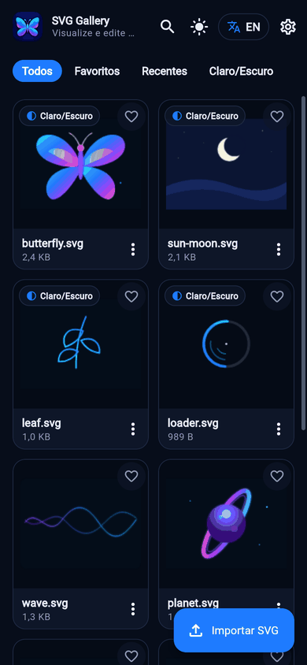
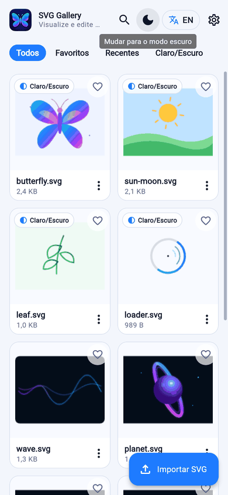
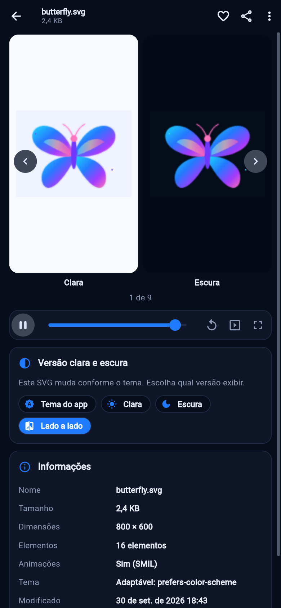
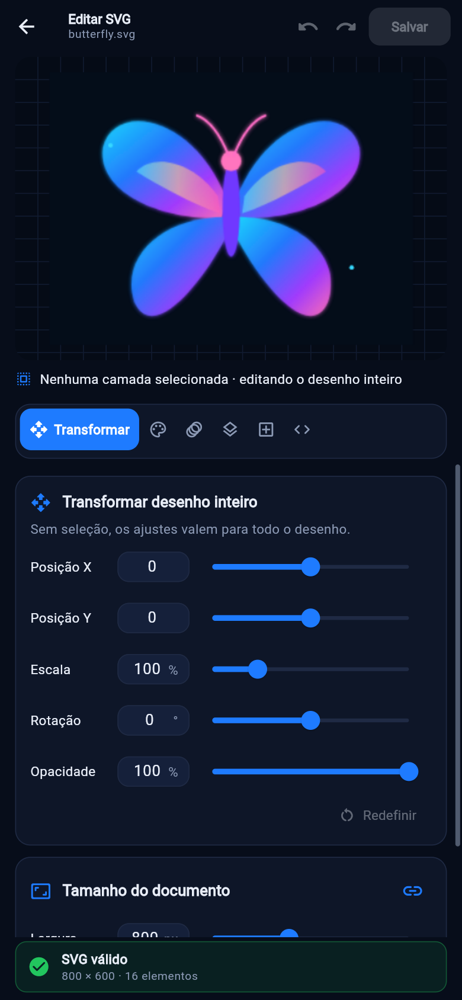
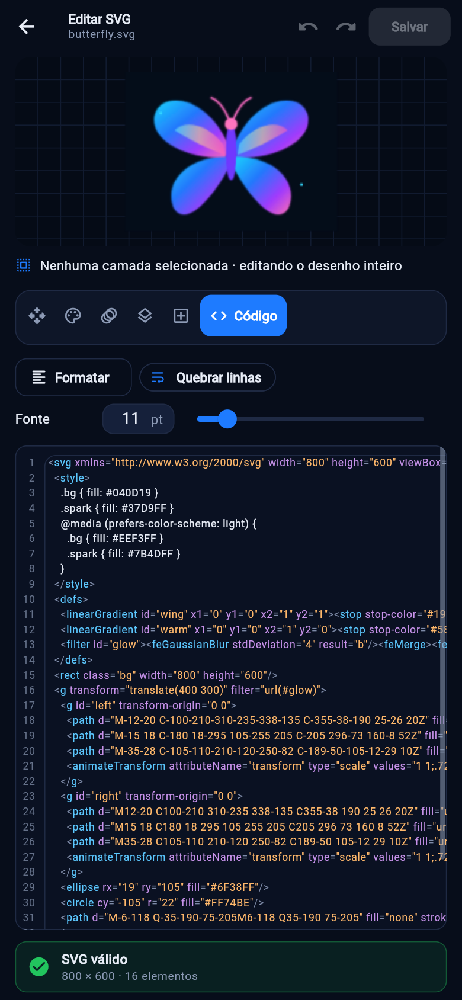

# SVG Motion Gallery v2

Aplicativo Flutter (Android e iOS, com build web para preview) para **ver, animar e editar arquivos SVG**. A v2 recomeça a [v1](https://github.com/lianeheidemann/svg-motion-gallery) como um projeto **modularizado**, com código reutilizável e integração contínua desde o primeiro commit.

| Galeria (escuro) | Galeria (claro) | Versão clara × escura | Editor | Código |
|---|---|---|---|---|
|  |  |  |  |  |

## Funcionalidades

- **Exibição automática**: as miniaturas da galeria e o visualizador reproduzem as animações CSS/SMIL reais (WebView no Android/iOS, iframe na web). O visualizador também tem uma **apresentação automática**, que passa sozinha de um arquivo para o próximo.
- **Versões clara e escura dos SVGs**: quando o arquivo muda conforme o tema, a galeria mostra o selo *Claro/Escuro*, a miniatura segue o tema do app e o visualizador oferece *Tema do app / Clara / Escura / Lado a lado*. São detectados quatro mecanismos:
  - `@media (prefers-color-scheme)`;
  - `light-dark()`;
  - `currentColor`;
  - seletores `[data-theme]`, `.dark` e `.light`.
- **Botões na tela inicial** para trocar o modo **claro/escuro** e **traduzir todo o app para o inglês** (PT ⇄ EN). Todos os textos vêm dos arquivos ARB, incluindo mensagens de validação, datas e números.
- **Edição real do SVG**, com desfazer/refazer para todos os tipos:
  - **Transformar**: posição, escala, rotação e opacidade do desenho inteiro ou da camada selecionada, além do tamanho do documento;
  - **Cores**: troca de uma cor em todo o arquivo (paleta) ou preenchimento/traço/espessura da camada, com sliders de matiz, saturação e luminosidade;
  - **Animação**: velocidade, remoção e movimentos prontos (girar, pulsar, flutuar, balançar, esmaecer);
  - **Camadas**: selecionar, mostrar/ocultar, reordenar, duplicar, excluir e editar texto;
  - **Inserir**: retângulo, círculo, elipse, linha, estrela e texto;
  - **Código**: realce de sintaxe, números de linha, quebra de linha, tamanho da fonte, formatação e validação ao vivo.
- **Barras de rolagem e sliders em todo lugar**:
  - todo ajuste numérico tem **slider + campo numérico** sincronizados: posição da animação, transformações, cores HSL, velocidade, tamanho da fonte, intervalo da apresentação etc.;
  - toda área rolável mostra uma **barra de rolagem arrastável**, vertical e horizontal (`AppScrollBehavior`).
- Importação de `.svg` (seleção múltipla, arquivos inválidos são recusados com aviso), favoritos, recentes, busca, renomear, duplicar, compartilhar e excluir.
- **SVGs do celular (Android)**: o app pede acesso aos arquivos e lista **todos os `.svg` do armazenamento** (Downloads, Pictures, WhatsApp, cartão SD…) no filtro **No celular** e em **Todos**. Veja [Permissão de arquivos](#permissão-de-arquivos-android).
  - Dá para **renomear, compartilhar, editar e apagar** esses arquivos direto pela galeria. Salvar uma edição sobrescreve o original (com cópia de segurança, se ligada nas configurações).
  - **Segure um card para selecionar vários** e apagar todos de uma vez. A confirmação diz quantos serão apagados definitivamente do celular e quantos só saem da galeria.
  - Puxe a lista para baixo para procurar de novo.
- Configurações:
  - reprodução automática, repetir animação, miniaturas em alta qualidade e intervalo da apresentação;
  - cor de destaque e **tamanho da interface** (slider de 50% a 120%, padrão **80%**; "Restaurar padrão" volta para 80%);
  - backup automático antes de salvar;
  - uso de armazenamento, limpar cópias e restaurar exemplos.

### Sem funções repetidas

A tela de referência tinha a mesma função em mais de um lugar. Na v2 cada função tem um único ponto de acesso por tela:

| Na referência | Na v2 |
|---|---|
| "Favoritos" no chip **e** na barra inferior; "Importar" no botão **e** na barra | Sem barra inferior: favoritos é filtro, importar é o botão flutuante, configurações fica no topo |
| "Abrir na edição" + "Editar SVG" | Um único **Editar SVG** |
| Barra lateral de ferramentas + abas do painel | Só as abas; cada ferramenta virou uma aba funcional |
| Editor visual + tela de código com aba *Preview* | Um único editor; **Código** é uma aba e o palco é o preview |
| Aba *Validação* + botão *Validar* + cartão de status | Validação ao vivo numa única barra de status; Salvar fica desabilitado se o SVG for inválido |
| *Salvar* + *Aplicar alterações* | O código vai para o preview sozinho; existe só **Salvar** |
| "Tema do app" nas configurações + botão pedido na tela inicial | Só o botão da tela inicial |

## Arquitetura

Monorepo com [pub workspaces](https://dart.dev/tools/pub/workspaces): o app fica na raiz e os módulos reutilizáveis em `packages/`. As dependências apontam sempre para baixo:

```text
                    app (lib/)
       ┌───────────────┼────────────────┐
       ▼               ▼                ▼
design_system      svg_view  ──────▶  svg_core
 (Flutter UI)   (renderização)     (Dart puro)
```

| Módulo | Responsabilidade |
|---|---|
| `packages/svg_core` | Dart puro, sem Flutter. Validação, formatação, metadados, detecção e resolução das variantes claro/escuro, sanitização (remove scripts e handlers), loop, todas as edições (funções `String → String`, imutáveis), realce de sintaxe e histórico de desfazer/refazer. |
| `packages/svg_view` | `SvgView`: renderiza o SVG preparado (sanitizar → resolver tema → loop → viewBox) com WebView (Android/iOS), iframe (web) ou `flutter_svg` (modo leve e testes, com CSS convertido em atributos). A ponte JS e o `SvgPlaybackController` permitem tocar, pausar, buscar e reiniciar. |
| `packages/design_system` | Tokens da referência, temas claro/escuro com cor de destaque, `AppScrollBehavior`, `UiScale` (reduz/aumenta o app inteiro) e widgets reutilizáveis: `SliderField`, `SectionCard`, `PillTabs`, `ScrollableChipBar`, `HslColorEditor`, `ColorSwatchPicker`, `StatusBanner`, `KeyValueTable`, `EmptyState`, `Stage`. |
| `lib/` (app) | Features (`gallery`, `viewer`, `editor`, `settings`), estado (`ChangeNotifier`), dados (repositório + armazenamento em arquivos/localStorage/memória), serviços (importar, compartilhar), i18n (ARB) e injeção de dependências simples (`AppScope`). |

As variantes claro/escuro são resolvidas em Dart (`SvgThemeResolver`) e não dependem do WebView seguir o tema. Assim o resultado é idêntico no Android, no iOS, na web e no `flutter_svg`, e dá para mostrar as duas versões lado a lado.

```text
lib/
  main.dart                 # composição: armazenamento, controladores, serviços
  src/
    app.dart                # MaterialApp: temas, idioma, scroll behavior
    app_scope.dart          # injeção de dependências
    data/                   # SvgDocument, SvgRepository, armazenamento, AppSettings
    state/                  # LibraryController, SettingsController
    services/               # importação (file_picker) e compartilhamento (share_plus)
    features/               # gallery/ viewer/ editor/ settings/
    widgets/                # botões tema/idioma, SvgPreview, menu de ações
    l10n/                   # app_pt.arb (modelo) e app_en.arb
packages/                   # svg_core/ svg_view/ design_system/
assets/svgs/                # demos (butterfly, sun-moon, leaf, loader são adaptáveis)
assets/icon/                # ícone do app: original (app_icon_source.png), adaptativo e logo da galeria; regerar com `dart run flutter_launcher_icons`
tool/check.sh               # as mesmas verificações do CI
```

## Permissão de arquivos (Android)

Para mostrar os SVGs do celular o app precisa de acesso aos arquivos:

| Android | Como a permissão é pedida |
|---|---|
| 11 ou mais novo | Na primeira abertura aparece **"Mostrar seus SVGs"**. Ao tocar em **Permitir**, o app abre a tela do sistema **"Acesso a todos os arquivos"**, onde você liga a chave do SVG Gallery. Ao voltar, a galeria confere sozinha e carrega tudo. Se você recusar, um aviso com **Permitir** fica na galeria. |
| 10 ou mais antigo | Popup normal de permissão de armazenamento. |

- **Ficam de fora:** pastas ocultas (começam com `.`) e `Android/data`, onde o Android bloqueia o acesso às pastas privadas de outros apps.
- **Não funciona no iOS nem na web** (sandbox): lá o recurso fica oculto.
- Apagar é **definitivo**: o app sempre pede confirmação antes.
- A permissão "todos os arquivos" é aceita normalmente no APK instalado pelo GitHub, mas a Play Store a restringe (só importaria se você publicar lá).
- Como funciona: `MainActivity.kt` só cuida da permissão, das raízes de armazenamento e de avisar o Android sobre mudanças. A varredura, a leitura, a escrita e a exclusão acontecem em Dart (`lib/src/services/device_*.dart`), atrás da interface `DeviceStorage`. Os SVGs do celular **nunca entram no índice da galeria**: o arquivo é a fonte da verdade, e o conteúdo só é lido quando o card aparece.

## Como rodar

Pré-requisito: Flutter **3.47.5** (o CI usa exatamente essa versão).

```bash
flutter pub get          # resolve o app e todos os pacotes do workspace
flutter run              # Android/iOS
flutter run -d chrome    # preview web
```

Um SVG é considerado adaptável quando usa, por exemplo:

```xml
<style>
  .bg { fill: #040D19 }
  @media (prefers-color-scheme: light) { .bg { fill: #EEF3FF } }
</style>
```

## Qualidade e testes

```bash
./tool/check.sh
```

O script roda, na ordem:
1. `flutter pub get` e `flutter gen-l10n`;
2. `dart format --set-exit-if-changed`;
3. `flutter analyze --fatal-infos`;
4. os testes de cada módulo.

Os testes estão divididos assim:
- `svg_core`: edições, tema, validação etc.
- `design_system`: widgets, tema e `UiScale` (tela virtual, toques, `MediaQuery`).
- `svg_view`: pipeline, HTML hospedeiro e controlador.
- App:
  - paridade das traduções;
  - repositório e controladores;
  - testes de widget dos fluxos principais: tema, idioma, filtros, importação, variantes, editor e salvar;
  - tamanho da interface: limites e persistência, colunas da galeria, diálogos, rolagem e o slider (só redimensiona ao soltar);
  - SVGs do celular: operações de arquivo em pastas temporárias, controlador com armazenamento em memória e telas (permissão, banner, seleção e exclusão).

Para ver as telas do celular no navegador (que não lê arquivos do aparelho), há um ponto de entrada de verificação com um "celular" em memória: `flutter build web -t tool/preview_device_main.dart`. Ele não faz parte do app.

## Integração contínua

| Workflow | Quando | O que faz |
|---|---|---|
| `ci.yml` | push em qualquer branch, PR, manual | `checks` → build do **APK** (artefato) e do **web preview** (artefato). Em *Actions → CI → Run workflow* com **release** marcado, publica o APK como **Release** `v<versão>-build<n>` |
| `checks.yml` | reutilizável | roda `tool/check.sh` e envia a cobertura |
| `android-build.yml` | reutilizável | `flutter build apk --release`; o número da execução vira o `versionCode` |

A action composta `.github/actions/setup-flutter` centraliza a versão do Flutter e do Java. O Dependabot atualiza pacotes pub e actions semanalmente.

## Limitações conhecidas

- O modo leve (`flutter_svg`, usado quando "alta qualidade" está desligada e nos testes) não executa animações nem filtros; o modo normal usa o motor do navegador.
- Edição de nós de caminhos (`path`) não está incluída.
- Importar pelo menu "Compartilhar/Abrir com" do Android (existia na v1) ainda não foi portado.
- Em celulares com milhares de SVGs, as miniaturas ficam estáticas enquanto a lista rola e voltam a animar ~0,3 s depois de parar, para não criar centenas de WebViews.
- O APK de release é assinado com a chave de debug, como na v1. Para publicar numa loja, configure uma keystore.
- O CI não compila iOS (runner macOS); o projeto iOS é gerado e compila localmente com Xcode.

## Licença

Projeto acadêmico e de portfólio. Consulte o arquivo [LICENSE](LICENSE) antes de redistribuir.
