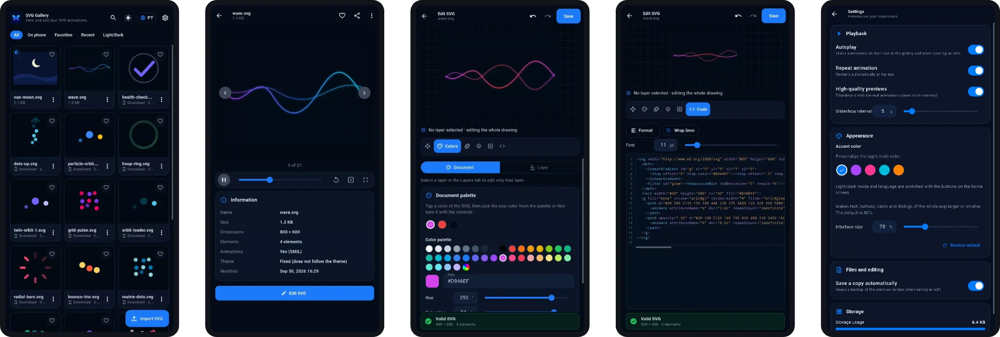

# SVG Motion Gallery

Aplicativo Flutter para **visualizar, animar e editar arquivos SVG**. Roda em Android e iOS, com build web para preview. É a v2 da [v1](https://github.com/lianeheidemann/svg-motion-gallery): modular, testada e com CI desde o primeiro commit.



## Destaques

- **Animações reais**: miniaturas e visualizador executam CSS/SMIL (WebView no Android/iOS, iframe na web), com apresentação automática.
- **SVGs claros e escuros**: detecta `prefers-color-scheme`, `light-dark()`, `currentColor` e seletores de tema; o visualizador mostra *Tema do app*, *Clara*, *Escura* ou *Lado a lado*.
- **Editor completo**, com desfazer/refazer: transformar, cores (paleta, seletor livre, hexadecimal e HSL), animações, camadas, inserir formas e código com realce e validação ao vivo.
- **SVGs do celular (Android)**: pede acesso aos arquivos, lista todos os `.svg` do aparelho e permite editar, renomear, compartilhar e apagar, inclusive vários de uma vez.
- **Ajustes por slider** em todo o app, inclusive o **tamanho da interface** (50% a 120%, padrão 80%).
- **Tema claro/escuro e português/inglês** trocados por botões na tela inicial; todos os textos vêm de arquivos ARB.

## Arquitetura

Monorepo com [pub workspaces](https://dart.dev/tools/pub/workspaces). As dependências apontam sempre para baixo:

```text
                app (lib/)
     ┌─────────────┼──────────────┐
     ▼             ▼              ▼
design_system   svg_view ─────▶ svg_core
  (Flutter UI)  (renderização)   (Dart puro)
```

| Módulo | Responsabilidade |
|---|---|
| `packages/svg_core` | Dart puro: validação, metadados, resolução de temas, sanitização, edições imutáveis (`String → String`) e histórico. |
| `packages/svg_view` | `SvgView` e controle de reprodução (WebView, iframe ou `flutter_svg`). |
| `packages/design_system` | Tokens, temas, `UiScale` e widgets reutilizáveis. |
| `lib/` | Telas (`gallery`, `viewer`, `editor`, `settings`), estado com `ChangeNotifier`, dados, serviços e i18n. |

## Começando

Requer Flutter **3.47.5**, a mesma versão do CI.

```bash
flutter pub get
flutter run              # Android ou iOS
flutter run -d chrome    # preview web
./tool/check.sh          # formatação, análise e todos os testes (o que o CI roda)
```

## SVGs de exemplo

Os exemplos ficam em **`assets/svgs/`**. Qualquer `.svg` colocado ou removido dessa pasta entra ou sai do APK seguinte; `butterfly` e `sun-moon` (os dois adaptáveis ao tema) aparecem primeiro e os demais em ordem alfabética. Hoje são três: `butterfly`, `sun-moon` e `wave`.

Os exemplos são copiados para a galeria **na primeira abertura** ou em *Configurações → Restaurar exemplos*. Quem já tem o app instalado mantém os arquivos que já tinha.

## Permissão de arquivos (Android)

- **Android 11+**: o app abre a tela do sistema "Acesso a todos os arquivos", onde você liga a chave. **Android 10 ou anterior**: permissão de armazenamento comum.
- Pastas ocultas e `Android/data` ficam de fora. Não há esse recurso no iOS nem na web.
- Apagar é definitivo e sempre pede confirmação. Os SVGs do celular nunca entram no índice da galeria: o arquivo é a fonte da verdade.
- A Play Store restringe essa permissão; ela só importa se você publicar lá.

## Integração contínua

| Workflow | Função |
|---|---|
| `ci.yml` | A cada push e PR: verificações, APK e web preview como artefatos. Com **release** marcado em *Run workflow*, publica a Release. |
| `release.yml` | *Actions → Release → Run workflow*: verificações opcionais, APK e publicação como `v<versão>-build<n>`. Só aparece quando o arquivo está na branch padrão. |
| `checks.yml`, `android-build.yml` | Partes reutilizáveis. |

O Dependabot atualiza pacotes e actions semanalmente.

## Limitações

- O modo leve (`flutter_svg`) não executa animações nem filtros.
- Edição de nós de `path` e abrir arquivos pelo "Compartilhar/Abrir com" do Android ainda não existem.
- O APK de release usa a chave de debug; para uma loja, configure uma keystore.
- O CI não compila iOS.

## Licença

Projeto acadêmico e de portfólio. Veja [LICENSE](LICENSE) antes de redistribuir.
