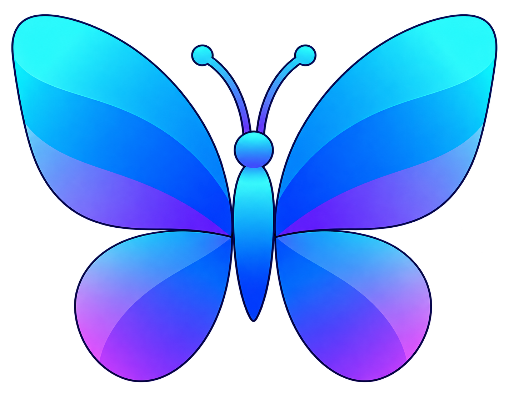
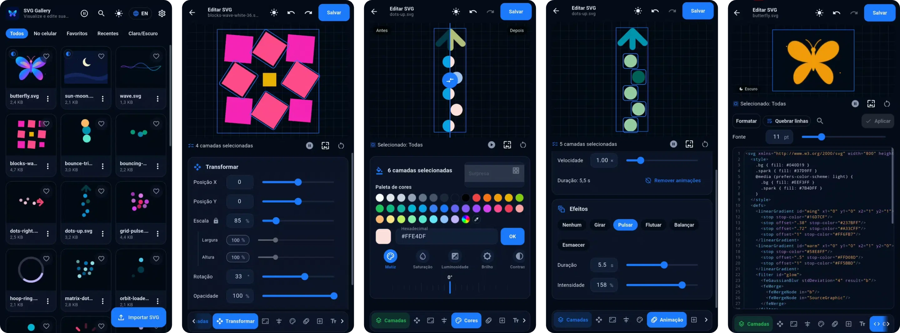
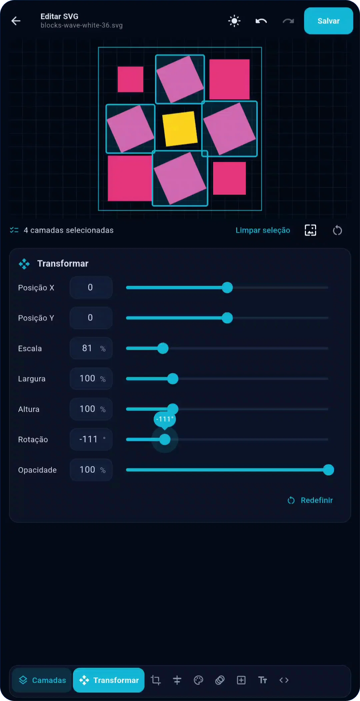

<p align="center">
  <picture>
    <source media="(prefers-color-scheme: dark)" srcset="docs/logo.png" />
    <source media="(prefers-color-scheme: light)" srcset="docs/logo-light.png" />
    
  </picture>
</p>


<div align="center">
  
# SVG Motion Gallery

<p><em>View, animate and edit SVG files on Android.</em></p>


<p>
  <a href="https://github.com/lianeheidemann/svg-motion-gallery/actions/workflows/ci.yml"></a>
  <a href="https://github.com/lianeheidemann/svg-motion-gallery/releases/latest"></a><br>
  
  
  
  
  
</p>

</div>


<p align="justify">SVG (Scalable Vector Graphics) is an XML-based vector format supporting resolution-independent graphics and animations through CSS and SMIL. Rendering performance depends on graphical complexity, filters, and animation behavior.</p>

<p align="justify">Despite its widespread use in web development, many mobile galleries lack native SVG previews and animation support.</p>

<p align="justify">SVG Motion Gallery was designed to address these limitations: animated SVGs play directly within the gallery, making files easier to identify at a glance.</p>

<p align="justify">It also includes a visual editor and a code editor for modifying SVG files (see <a href="#the-editor">The editor</a>).</p>

<p align="justify">The project aims to simplify SVG visualization, editing, experimentation, and reuse, particularly for animated icons and interface elements.</p>

<p align="justify"><strong>Tech stack:</strong> Flutter · Dart · XML · CSS · SMIL</p>


<div align="center">
    


</div>


## Highlights

- **Real animations**: thumbnails and the viewer run CSS/SMIL (WebView on Android/iOS, iframe on the web), with automatic playback that can be turned off in favor of static previews to reduce processing load.
- **Light and dark SVGs**: detects `prefers-color-scheme`, `light-dark()`, `currentColor` and theme selectors; the viewer shows *App theme*, *Light*, *Dark* or *Side by side*.
- **Full editor** with undo/redo: nine tabs (see [The editor](#the-editor)) for layers, transform, window, alignment, colors, animation, shapes, text and code with highlighting and live validation.
- **SVGs on the phone (Android)**: asks for file access, lists every `.svg` on the device and lets you edit, rename, share and delete them, several at once included.
- **Slider settings** across the app, including the **interface size** (50% to 120%, default 80%).
- **Light/dark theme and Portuguese/English** switched with buttons on the home screen; all texts come from ARB files.

## The editor

On SVGs with light and dark variants, a small *Light*/*Dark* label in the bottom corner of the stage tells which version is on screen and being edited, on every tab.

| Tab | What it does |
|---|---|
| **Layers** | Layer tree with single or multiple selection (ticking a folder ticks everything in it, and a folder is ticked when all of it is), ordering, duplicate, show/hide and delete in a row that slides sideways. Hiding a folder greys out and locks the layers inside it. On light/dark SVGs a wide button names the theme being edited and switches it, and each layer shows a sun, a moon or both: solid when the setting is on the layer itself, outlined and marked "inherits" when it comes from a group around it. Tapping the marks opens the layer's theme settings, where only the theme on the stage can be changed. |
| **Transform** | Position, scale (with a proportion lock), width and height (sub-options of scale, free once the lock is open), rotation and opacity. A layer's move/rotation and its preset motion are kept in two editor groups around it (`data-sm-edit`, `data-sm-anim`), so its own transform and animations keep working; they are part of the layer, not rows of their own, and edits reuse them instead of stacking more. |
| **Window** | Crop of the drawing: aspect ratio (1:1, 4:3, 3:4, 16:9, 9:16), width, height and a margin around the content. |
| **Align** | Aligns the layer to the canvas. |
| **Colors** | On light/dark SVGs a strip on top says which theme is being painted (only that one changes) and switches to the other. Before/After side by side with the same crop; palette, free picker, hex and eyedropper; an adjustment row (hue, saturation, lightness, brightness, contrast…) that swipes sideways. Outline-only shapes get their stroke painted, even when `fill="none"` comes from the group. The stage starts paused and the play button still works. |
| **Animation** | Works on what is selected (the whole drawing when nothing is): **Animation** shows its length and changes its speed or removes it; **Effects** (spin, pulse, float, sway, fade) replace whatever animation the selected layers had. |
| **Insert** / **Text** | Add shapes and text. Color, size, width, height, outline and "Filled" stay greyed out until a shape (or text) from that tab is selected. |
| **Code** | Editor with highlighting, line numbers, search, format and **Wrap lines**, which keeps the indent of the line it comes from (including the text of `<title>` and `<desc>`). |

## Architecture

Monorepo with [pub workspaces](https://dart.dev/tools/pub/workspaces). Dependencies always point downward:

```text
                app (lib/)
     ┌─────────────┼──────────────┐
     ▼             ▼              ▼
design_system   svg_view ─────▶ svg_core
  (Flutter UI)  (rendering)      (pure Dart)
```

| Module | Responsibility |
|---|---|
| `packages/svg_core` | Pure Dart: validation, metadata, theme resolution, sanitizing, immutable edits (`String → String`) and history. |
| `packages/svg_view` | `SvgView` and playback control (WebView, iframe or `flutter_svg`). |
| `packages/design_system` | Tokens, themes, `UiScale` and reusable widgets. |
| `lib/` | Screens (`gallery`, `viewer`, `editor`, `settings`), `ChangeNotifier` state, data, services and i18n. |

## Getting started

Requires Flutter **3.47.5**, the same version as CI.

```bash
flutter pub get
flutter run              # Android or iOS
flutter run -d chrome    # web preview
./tool/check.sh          # formatting, analysis and all tests (what CI runs)
```

## Sample SVGs

The samples live in **`assets/svgs/`**. Any `.svg` added to or removed from that folder goes in or out of the next APK; `butterfly` and `sun-moon` (the two theme-adaptive ones) come first and the rest in alphabetical order. Today there are fifteen: `butterfly`, `sun-moon`, `blocks-wave-white-36`, `bounce-trio`, `bouncing-dots`, `dots-right`, `dots-up`, `grid-pulse`, `hoop-ring`, `matrix-dots`, `orbit-loader`, `particle-orbit`, `radial-bars`, `twin-orbit` and `wave`.

The samples are copied to the gallery **on first launch** or via *Settings → Restore samples*. Anyone who already has the app installed keeps the files they had.

## File permission (Android)

- **Android 11+**: the app opens the system "All files access" screen, where you turn the switch on. **Android 10 or earlier**: regular storage permission.
- Hidden folders and `Android/data` are left out. This feature does not exist on iOS or the web.
- Deleting is permanent and always asks for confirmation. Phone SVGs never enter the gallery index: the file is the source of truth.
- The Play Store restricts this permission; it only matters if you publish there.

## Continuous integration

| Workflow | Purpose |
|---|---|
| `ci.yml` | On every push and PR: checks, APK and web preview as artifacts. With **release** ticked in *Run workflow*, it publishes the Release. |
| `release.yml` | *Actions → Release → Run workflow*: optional checks, APK and publishing as `v<version>-build<n>`. Only listed once the file is on the default branch. |
| `checks.yml`, `android-build.yml` | Reusable parts. |

Dependabot updates packages and actions weekly.

## Limitations

- The lightweight mode (`flutter_svg`) does not run animations or filters.
- Editing `path` nodes and opening files through Android's "Share/Open with" do not exist yet.
- The release APK uses the debug key; for a store, set up a keystore.
- CI does not build iOS.

## Other Previews

<div align="center">



</div>

## License

Academic and portfolio project. See [LICENSE](LICENSE) before redistributing.
